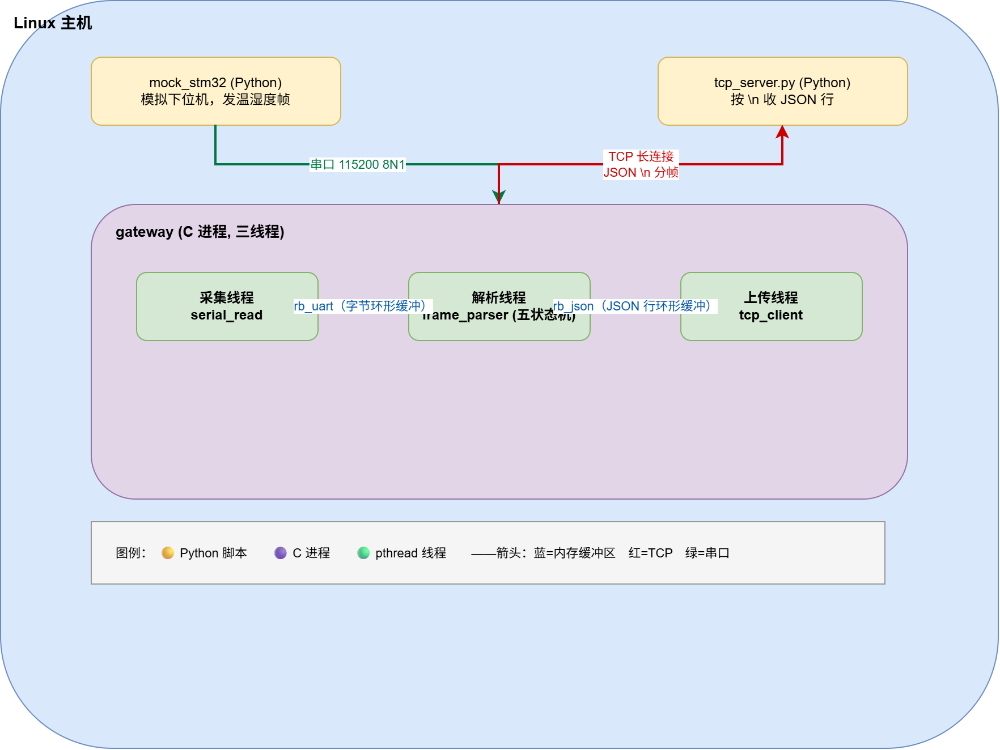
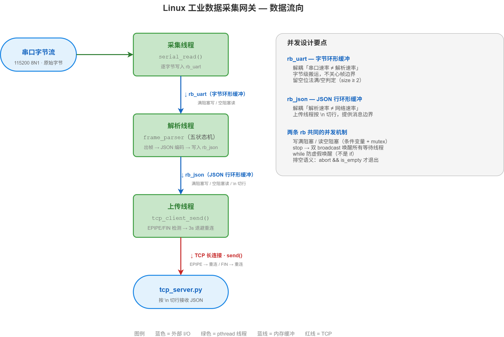

# Linux 工业数据采集网关

> C 语言实现的工业网关：串口采集下位机私有协议帧，解析后经 TCP 长连接上传服务端。
> 三线程 + 双环形缓冲区流水线，支持半包/粘包/坏帧重同步与断线自动重连。

## 1. 项目简介

下位机（模拟 STM32 的 Python 脚本）通过串口上报温湿度帧，网关在 Linux 侧用 termios 原始模式持续读取原始字节流，经五状态机解析出完整帧并编码为 JSON，最后经 TCP 上传到服务端。三个线程用两个线程安全环形缓冲区解耦采集/解析/上传三级速率，断线后自动重连，Ctrl+C 优雅退出。

```
目录结构：
include/   对外接口（logger / ringbuffer / serial / frame / tcp_client）
src/       实现 + main.c（三线程管线）
test/      单元测试（ringbuffer / logger / frame / serial）
tools/     mock_stm32.py（模拟下位机，含噪声攻击）、tcp_server.py（服务端）
build/     编译产物（不进 git）
```

## 2. 系统架构

```
                  ┌─────────────┐
                  │ mock_stm32  │  模拟下位机，串口发温湿度帧
                  └──────┬──────┘
                         │ 串口 (/tmp/ttySTM32 ↔ /tmp/ttyGateway)
                         ▼
┌──────────────────────────────────────────────────────────────┐
│  gateway 进程                                                 │
│                                                              │
│  ┌──────────────┐    rb_uart     ┌──────────────┐            │
│  │ 采集线程      │──────────────▶│ 解析线程      │            │
│  │ serial_read  │  字节环形缓冲  │ frame_parser │            │
│  └──────────────┘               └──────┬───────┘            │
│                                        │ rb_json             │
│                                        │ JSON行环形缓冲       │
│                                        ▼                     │
│                              ┌──────────────┐               │
│                              │ 上传线程      │──TCP──▶ 服务端 │
│                              │ tcp_client   │               │
│                              └──────────────┘               │
└──────────────────────────────────────────────────────────────┘
```

三线程共享 `gateway_ctx_t` 上下文（约定谁碰哪个字段），帧解析状态机 `frame_parser_t` 由解析线程私有持有，天然线程安全。





## 3. 功能列表

- [x] 串口原始模式采集（termios，115200 8N1，VMIN=0/VTIME=20 超时读）
- [x] 线程安全环形缓冲区（互斥锁 + 双条件变量 + abort 广播停止 + 排空语义）
- [x] 私有协议帧解析状态机（五状态，坏帧自动重同步）
- [x] JSON 编码上传（TCP 长连接，按 `\n` 分帧）
- [x] 断线检测与自动重连（peer closed 检测 + 3 秒退避重连）
- [x] 分级日志（时间戳 / 级别 / 文件:行号，多线程整行不交叉）
- [x] 信号驱动优雅退出（SIGPIPE 全局忽略 + SIGINT/SIGTERM → 三线程收敛退出）
- [x] 命令行参数化（串口路径 / 服务器 IP / 端口，均支持默认值）

## 4. 私有帧协议

```
| 0xAA | 0x55 | LEN(1B) | PAYLOAD(LEN B) | CHECKSUM(1B) |
  帧头1   帧头2   1..64       数据区           校验
```

- **CHECKSUM** = (LEN + 所有 PAYLOAD 字节逐字节累加) & 0xFF（累加范围不含两个帧头）。
- 温湿度 payload 固定 4 字节，**大端**：
  - `payload[0..1]`：温度 int16，单位 0.1℃
  - `payload[2..3]`：湿度 int16，单位 0.1%RH
- 例：25.7℃（257 = 0x0101）/ 65.3%RH（653 = 0x028D）
  → 帧 `AA 55 04 01 01 02 8D 95`（CHK = 0x04+0x01+0x01+0x02+0x8D = 0x95）
- 五状态：`SEEK_H1 → SEEK_H2 → SEEK_LEN → SEEK_PAYLOAD → SEEK_CHECK`
  - `SEEK_H2` 遇 `0xAA` 原地停留，正确处理 `AA AA 55` 双帧头
  - 非法 LEN（0 或 >64）丢帧重同步；校验失败只丢当前帧，回到 `SEEK_H1` 继续吃后续字节

## 5. 编译与运行

### 5.1 依赖

- gcc / make
- python3 + pyserial（`pip3 install pyserial`）
- socat（虚拟串口对）

### 5.2 编译

```bash
make            # 产出 build/gateway 及 4 个测试程序
```

### 5.3 快速开始

**终端 0：建虚拟串口对（固定设备名，clone 后照抄即可）**

```bash
rm -f /tmp/ttyGateway /tmp/ttySTM32
socat -d -d pty,raw,echo=0,link=/tmp/ttyGateway pty,raw,echo=0,link=/tmp/ttySTM32
```

**终端 1：服务端**

```bash
python3 -u tools/tcp_server.py
```

**终端 2：网关**（三个参数都可省略，默认值即 `/tmp/ttyGateway` / `127.0.0.1` / `9000`）

```bash
./build/gateway
# 等价于：./build/gateway /tmp/ttyGateway 127.0.0.1 9000
```

**终端 3：模拟下位机**（端口参数可省略，默认 `/tmp/ttySTM32`）

```bash
python3 -u tools/mock_stm32.py                 # 正常温湿度帧
python3 -u tools/mock_stm32.py --noise         # 噪声/坏帧/截断攻击
```

### 5.4 单元测试

```bash
make test
# 依次运行 test_ringbuffer / test_logger / test_frame，
# PASS/FAIL 计数 + 程序退出码反映成败。
# test_serial 已编译但不进 make test（它依赖真实串口设备，需手动传 /dev/ttyXXX）。
```

## 6. 测试方法与结果

| 测试 | 方法 | 结论 |
|---|---|---|
| 帧解析单测 | test_frame.c，8 用例 33 断言 | 全过 |
| 环形缓冲 | test_ringbuffer.c（含 drain 慢消费者排空测试） | 顺序对、不丢帧 |
| 日志模块 | test_logger.c，4 用例（DEBUG 过滤 + 三级落盘） | 全过 |
| 端到端 | socat 虚拟串口 + 三终端联调 | 解析数值与发送端一致 |
| 鲁棒性（噪声） | mock 六种线路攻击（半包/粘包/坏校验/非法LEN/纯噪声/假帧头）轮发 | 坏帧丢弃记 WARN，后续好帧照常解析 |
| 长稳 | 正常模式持续收发 | 60 秒零丢帧 |
| 断线重连 | 关服务端 → 重启 | 进程存活，3 秒内自动恢复上传 |
| 优雅退出 | Ctrl+C | 各线程退出日志 → exit code 0，无僵尸线程 |

## 7. 踩坑记录

以下是 6 天开发中遇到的真实问题，按严重程度排序：

| # | 现象 | 根因 | 修法 | 知识点 |
|---|---|---|---|---|
| 1 | `0xAA` 比较永假，`-Wall` 零警告 | plain char 在 x86 上有符号，0xAA(170)→-86，整值提升后 `-86 == 170` 永假 | 协议字节统一 `uint8_t` | C 标准 implementation-defined；STM32 arm-gcc char 无符号 → 同一代码在两个平台行为不同 |
| 2 | 关服务端后网关进程被杀 | `send()` 到已关闭连接触发 SIGPIPE，默认动作是杀进程 | `sigaction(SIGPIPE, SIG_IGN)` 全局忽略，send 只返回 EPIPE | MSG_NOSIGNAL 只能遮单次 send；全局忽略一劳永逸 |
| 3 | 断线 + Ctrl+C 后进程卡死不退 | upload 线程退出时未 stop 管线 → 缓冲区满 → collect 永久卡在 `cond_wait`，无人唤醒 | upload 退出路径全部收口到 `done:` 标签，统一 stop 双 RB；collect 也对称 stop | 优雅退出关键不在信号，在退出线程必须唤醒阻塞线程 |
| 4 | 串口设了 VMIN/VTIME 但超时不生效 | `cfmakeraw()` 内部执行 `c_cc[VMIN]=1; c_cc[VTIME]=0`，覆盖了之前的设置 | VMIN/VTIME 写在 `cfmakeraw()` **之后** | cfmakeraw 会重置控制字符，顺序决定生死 |
| 5 | 串口无数据时像卡死 | VMIN=0 模式下，VTIME 超时 `read` 返回 0——这是正常心跳，不是错误 | `n == 0` → continue，不作为错误退出 | 模式 B 语义：有数据立刻返回，无数据等 VTIME*0.1s 返回 0 |
| 6 | 偶发唤醒后条件不成立 | POSIX 允许 `pthread_cond_wait` 虚假唤醒（没人 signal 也自己醒） | `while` 包裹而非 `if`，醒来重新检查条件 | 两个原因：虚假唤醒 + 多消费者抢空 |
| 7 | size=1 环形缓冲永远不可写 | `head==tail` 同时表示空/满，留空位法下容量退化为 0 | `ringbuffer_init` 拒绝 `size < 2` | 环形缓冲空满判定经典问题，留空位法必须 size≥2 |
| 8 | 校验通过但温湿度是乱数 | 累加校验满足交换律，字节换位后和不变——端序盲区 | 两端约定大端 + 手工拼拆 `(payload[0]<<8)|payload[1]`，禁止 memcpy 进结构体 | 校验和只看和、不关心顺序；结构体有对齐填充+端序+移植性三坑 |
| 9 | `volatile` 做跨线程标志位不合法 | C11 下 `volatile` 只保证信号处理器↔被中断线程，跨线程是 data race (UB) | 改用 `atomic_int` + `memory_order_relaxed` | volatile 不保证原子性，C11 `_Atomic` 才管 |
| 10 | `make test` 不含 `test_serial` | test_serial 需要真实串口设备 | Makefile test target 只跑 ringbuffer/logger/frame，serial 手动跑 | 依赖硬件的测试不能进自动化回归 |

## 8. 已知限制与后续改进

- **阻塞 `connect()` 无超时**：本机/局域网靠快速 RST 快速失败；广域网断链会卡到内核 SYN 超时。改进方向：非阻塞 connect + `select` 超时。
- **重连重发整行**：断在传输中途会重发整行，服务端可能收到"半行+整行"；当前靠服务端按 `\n` 切分 + JSON 解析失败丢弃兜底，未做序号去重。
- **校验和交换律盲区**：累加和不检测字节顺序，端序错误恰好不改变和时会漏过。改进方向：升级为 CRC16 或加帧序号。